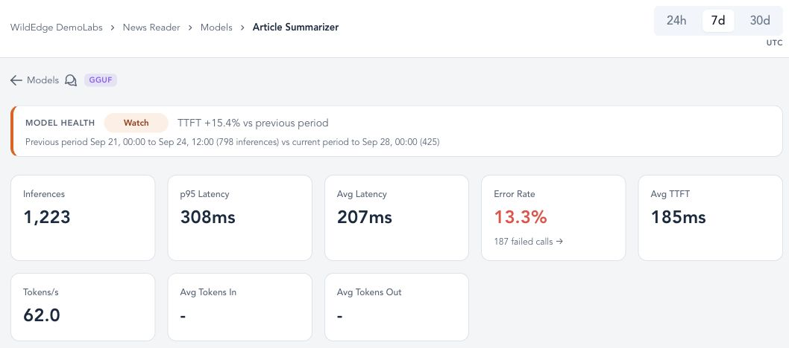
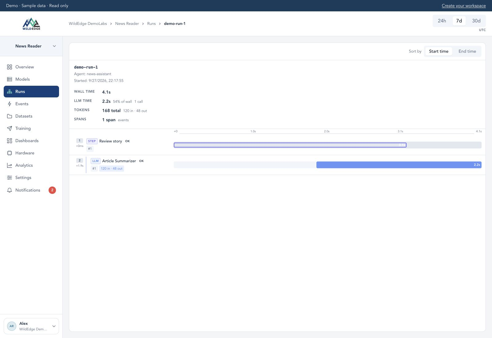
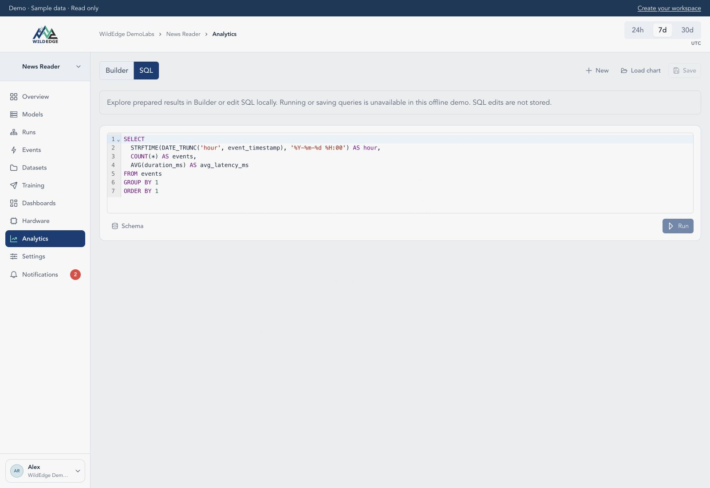
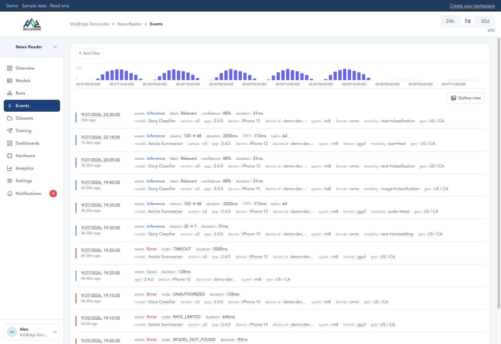
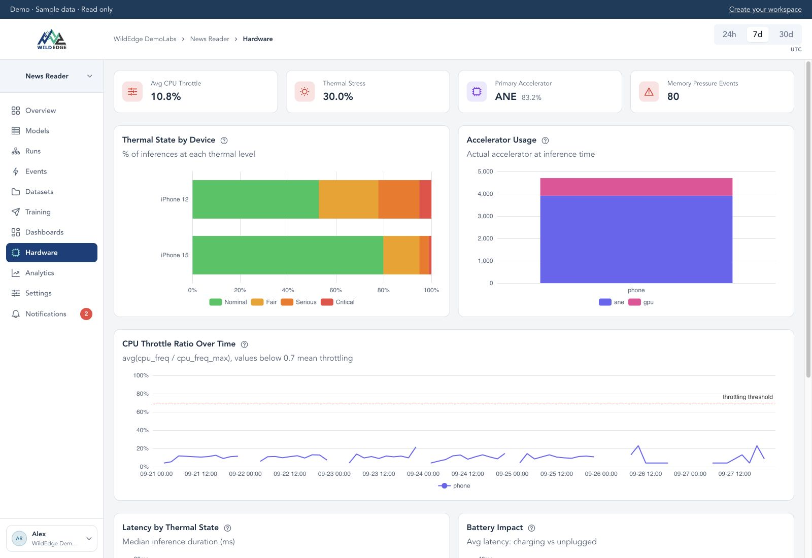

<p align="center">
  
</p>

<br/>

[](https://github.com/wild-edge/wildedge-python/actions/workflows/ci.yml)
[](https://pypi.org/project/wildedge-sdk/)
[](https://github.com/wild-edge/wildedge-python/actions/workflows/ci.yml)
[](https://github.com/wild-edge/wildedge-python/actions/workflows/ci.yml)
[](https://github.com/wild-edge/wildedge-python/actions/workflows/ci.yml)
[](https://pypi.org/project/wildedge-sdk/)
[](https://codecov.io/gh/wild-edge/wildedge-python)

Monitor local and remote ML inference from Python. Track latency, token usage,
errors, model metadata, and local hardware context across llama.cpp, MLX,
Transformers, OpenAI, and more.

Instrument supported libraries with one command, or add tracking in your code.
Prompts and outputs aren't uploaded unless you explicitly attach them.

**[Get started](#install)** · [Explore the demo](https://wildedge.dev/demo) · [Docs](https://docs.wildedge.dev) · [Website](https://wildedge.dev)

| Model performance | Workflow trace | SQL editor |
|:---:|:---:|:---:|
| <a href="docs/images/demo-model-performance.jpg"></a> | <a href="docs/images/demo-trace.jpg"></a> | <a href="docs/images/demo-sql.jpg"></a> |

*Demo sample data across WildEdge SDKs. Click a thumbnail for the full-size image,
or [explore the read-only demo](https://wildedge.dev/demo).*

<details>
<summary>More screenshots: events and hardware</summary>

| Events | Hardware |
|:---:|:---:|
| <a href="docs/images/demo-events.jpg"></a> | <a href="docs/images/demo-hardware.jpg"></a> |

</details>

## Install

```bash
uv add wildedge-sdk
```

To send events, sign up at [app.wildedge.dev](https://app.wildedge.dev), create a project and copy its DSN. Without a DSN everything is a silent no-op, so dev and CI need no configuration.

## CLI

Monitor an existing application by adding `wildedge run` to its start command:

```bash
WILDEDGE_DSN="https://<secret>@ingest.wildedge.dev/<key>" \
uv run wildedge run --integrations llama_cpp -- python app.py
```

This assumes your application already uses `llama-cpp-python`. The `llama_cpp`
integration instruments that library; replace it with your
[integration](#supported-integrations).
No SDK calls are required in your application code.

See the [deployment guide](docs/deployment.md) for startup options,
environment validation, and production configuration.

## SDK

To try tracking in your code, run one local text-generation model on CPU.
Install the model's dependencies:

```bash
uv add transformers torch
```

Save this as `app.py`. The first run downloads the model from Hugging Face;
no model-provider API key is needed.

```python
import wildedge
from transformers import pipeline

client = wildedge.init(integrations=["transformers"])
try:
    model = pipeline(
        "text-generation",
        model="HuggingFaceTB/SmolLM2-360M-Instruct",
        device=-1,  # CPU
    )
    result = model(
        "Explain how rain forms in one sentence.",
        max_new_tokens=32,
        do_sample=False,
        return_full_text=False,
    )
    print(result[0]["generated_text"])
finally:
    client.close(timeout=10)
```

Set the DSN from your WildEdge project and run it:

```bash
export WILDEDGE_DSN="https://<secret>@ingest.wildedge.dev/<key>"
uv run python app.py
```

Open your project at [app.wildedge.dev](https://app.wildedge.dev) to inspect the
model load and inference events, including duration and model metadata. The
generated text is printed locally; it isn't uploaded.

Already have an application? Initialize WildEdge before creating your model or
API client. See [examples for each integration](#supported-integrations),
[traces and spans](docs/manual-tracking.md#track-spans-for-agentic-workflows),
and the [deployment guide](docs/deployment.md) for lifecycle details.

<details>
<summary>Trace a workflow across local and remote models</summary>

Combine integrations and group inference calls into traces and spans. This
example also requires `uv add openai` and an `OPENAI_API_KEY`, alongside the
Transformers dependencies and WildEdge DSN above.

```python
import wildedge
from openai import OpenAI
from transformers import pipeline

client = wildedge.init(integrations=["transformers", "openai"])
try:
    local = pipeline(
        "text-generation",
        model="HuggingFaceTB/SmolLM2-360M-Instruct",
        device=-1,
    )
    remote = OpenAI()
    prompt = "Explain how rain forms in one sentence."

    with wildedge.trace(run_id="run-1"):
        with wildedge.span(kind="agent_step", name="draft"):
            draft = local(
                prompt, max_new_tokens=32, return_full_text=False
            )[0]["generated_text"]
        with wildedge.span(kind="agent_step", name="refine"):
            response = remote.chat.completions.create(
                model="gpt-4o-mini",
                messages=[{"role": "user", "content": draft}],
            )
            print(response.choices[0].message.content)
finally:
    client.close(timeout=10)
```

Both inference calls belong to one trace, with separate `draft` and `refine`
spans. See [manual tracking](docs/manual-tracking.md#track-spans-for-agentic-workflows)
for additional span types and context.

</details>

## Supported integrations

**Local inference:** llama.cpp, Transformers, MLX-LM, ONNX Runtime, PyTorch,
TensorFlow, Keras, Ultralytics, timm, faster-whisper, and MLX Whisper.

**API clients:** OpenAI, Anthropic, and OpenAI-compatible providers.

Most integrations track supported entry points automatically after activation.
PyTorch and standalone Keras models require explicit registration.

<details>
<summary>Integration keys, setup, and examples</summary>

Enable the integration before creating models or API clients, using
`--integrations` or `wildedge.init(integrations=[...])`. Automatic tracking
covers the entry points listed below. PyTorch and standalone Keras models need
explicit registration through `client.load(...)` or `client.register_model(...)`.

**Local models**

| Library | Integration key | How tracking starts | Example |
|---|---|---|---|
| Transformers | `transformers` | Automatically through `pipeline` / `from_pretrained` | [Example](examples/transformers_example.py) |
| llama.cpp (`llama-cpp-python`) | `llama_cpp` | Automatically when constructing `Llama` | [Example](examples/gguf_example.py) |
| MLX-LM | `mlx` | Automatically through `mlx_lm.load` | [Example](examples/mlx_example.py) |
| faster-whisper / MLX Whisper | `faster_whisper` / `mlx_whisper` | Automatically through supported model loaders | [Example](examples/whisper_example.py) |
| ONNX Runtime | `onnx` | Automatically when constructing `InferenceSession` | [Example](examples/onnx_example.py) |
| timm | `timm` | Automatically through `create_model` | [Example](examples/timm_example.py) |
| Ultralytics | `ultralytics` | Automatically when constructing `YOLO` | — |
| TensorFlow | `tensorflow` | Automatically through `keras.models.load_model` / `saved_model.load`; register models created in code | [Example](examples/tensorflow_example.py) |
| PyTorch | `torch` | Register the model explicitly | [Example](examples/pytorch_example.py) |
| Keras | `keras` | Register the model explicitly | [Example](examples/keras_example.py) |

**API clients**

| Library | Integration key | How tracking starts | Example |
|---|---|---|---|
| Anthropic | `anthropic` | Automatically for clients created after initialization | [Example](examples/anthropic_example.py) |
| OpenAI | `openai` | Automatically for clients created after initialization | [Example](examples/openai_example.py) |

</details>

<details>
<summary>API coverage and compatible providers</summary>

Fireworks, Together, Baseten, xAI, Mistral, Groq and other OpenAI-compatible hosts
work through the `openai` integration — pass their `base_url`. See
[Providers](https://github.com/wild-edge/wildedge-python/blob/main/docs/providers.md)
for every recognized endpoint.

See [API tracking](docs/providers.md) for endpoint coverage, streaming, embeddings,
and tracking calls made without the official client libraries.

</details>

<details>
<summary>Model download tracking</summary>

**Hub tracking**

Pass `hubs=` to track model download provenance. Hubs are framework-agnostic and can be combined with any integration.

| Hub | Tracks |
|---|---|
| `huggingface` | Downloads via `huggingface_hub` |
| `torchhub` | Downloads via `torch.hub` |

</details>

For unsupported frameworks, see [Manual tracking](https://github.com/wild-edge/wildedge-python/blob/main/docs/manual-tracking.md).

## Configuration

| Parameter | Default | Description |
|---|---|---|
| `dsn` | - | `https://<secret>@ingest.wildedge.dev/<key>` (or `WILDEDGE_DSN`). If unset, the client is a no-op. |
| `app_version` | `None` | Your app's version string |
| `app_identity` | `<project_key>` | Namespace for offline persistence. Set per-app in multi-process workloads (or `WILDEDGE_APP_IDENTITY`) |
| `enable_offline_persistence` | `true` | Persist unsent events to disk and replay on restart |
| `sampling_interval_s` | `30.0` | Seconds between background hardware snapshots. Set to `0` or `None` to disable (or `WILDEDGE_SAMPLING_INTERVAL_S`) |
| `attachments_enabled` | `false` | Opt-in upload of raw inference inputs/outputs (or `WILDEDGE_ATTACHMENTS_ENABLED`). See [Attachments](https://github.com/wild-edge/wildedge-python/blob/main/docs/configuration.md#attachments) |

For advanced options (batching, queue tuning, dead-letter storage, attachments), see [Configuration](https://github.com/wild-edge/wildedge-python/blob/main/docs/configuration.md).

## Security & Privacy

Automatic integrations send inference metrics, model metadata, and device/hardware
information, including a device identifier, OS information, locale, and timezone.
They do not attach raw inputs or outputs. Raw payload uploads require explicitly
supplied [attachments](docs/configuration.md#attachments) and
`attachments_enabled=True`.

Report security and privacy issues to: support@wildedge.dev

## Links

- [Deployment guide](https://github.com/wild-edge/wildedge-python/blob/main/docs/deployment.md)
- [Manual tracking](https://github.com/wild-edge/wildedge-python/blob/main/docs/manual-tracking.md)
- [LLM API tracking](https://github.com/wild-edge/wildedge-python/blob/main/docs/llm_api.md)
- [Compatibility Matrix](https://github.com/wild-edge/wildedge-python/blob/main/docs/compatibility.md)
- [Streaming lifecycle](docs/streaming.md)
- [Changelog](https://github.com/wild-edge/wildedge-python/blob/main/CHANGELOG.md)
- [License](https://github.com/wild-edge/wildedge-python/blob/main/LICENSE)
